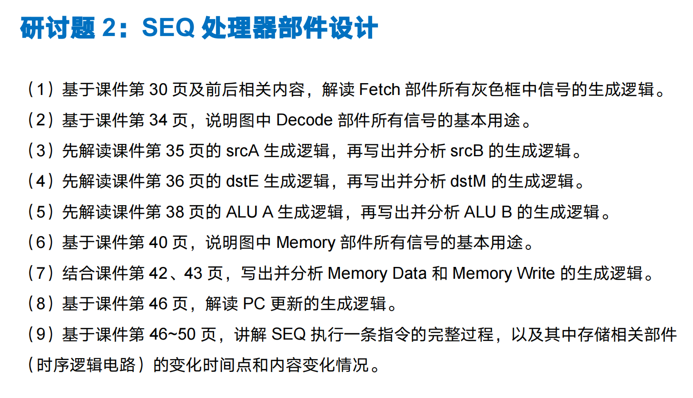
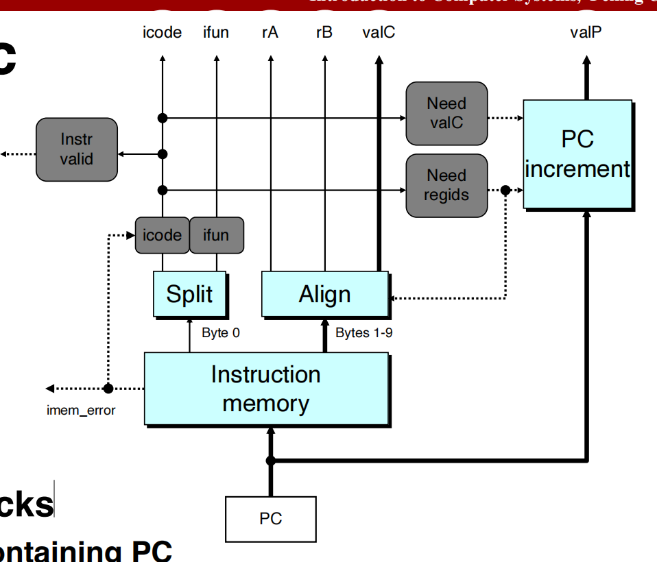
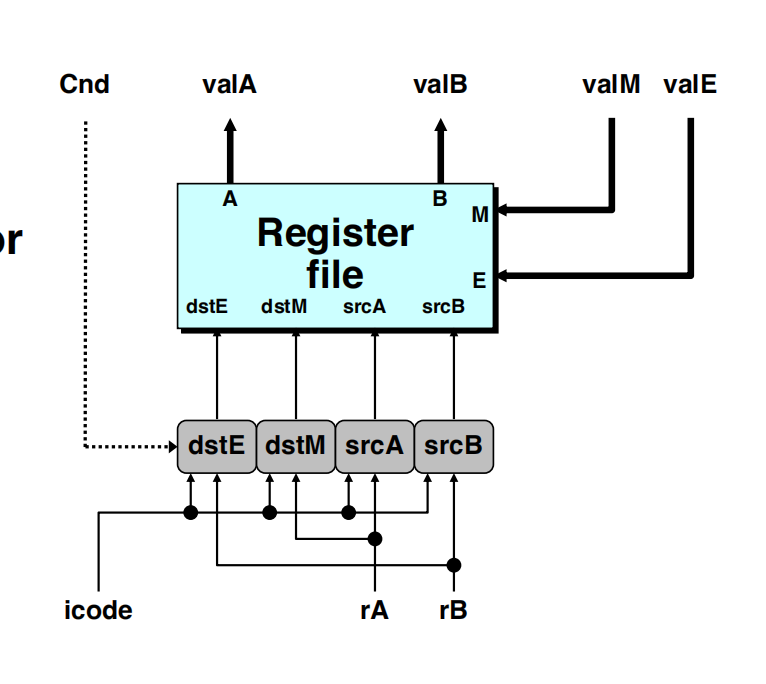
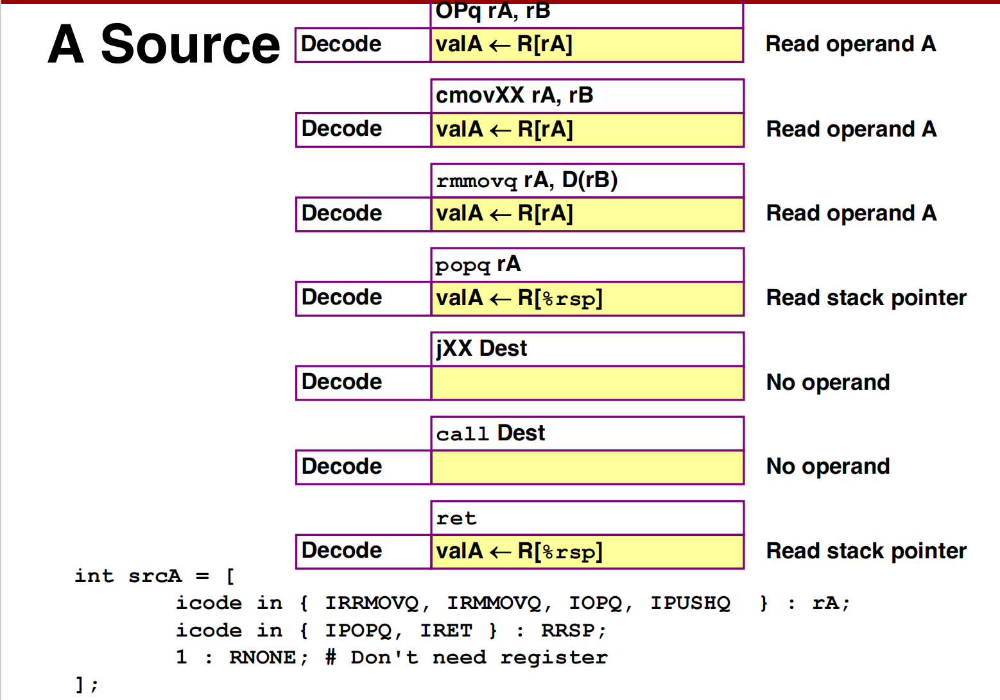
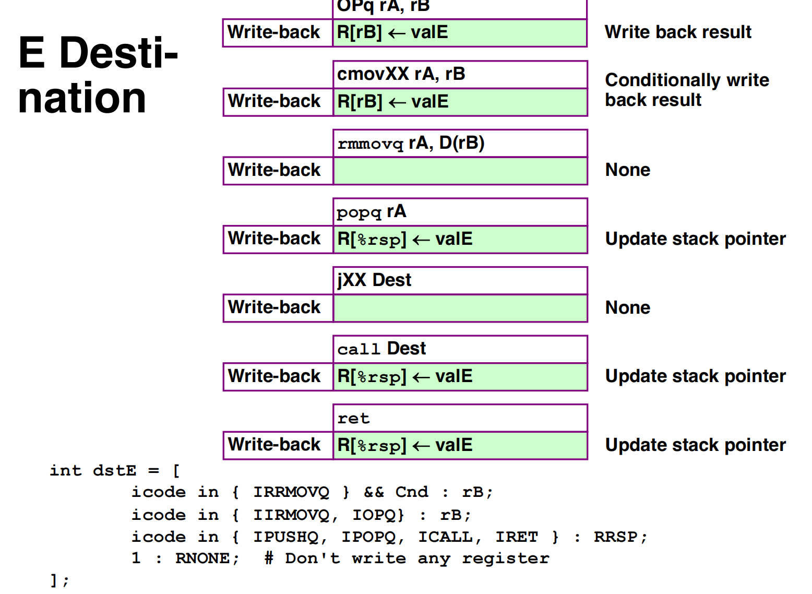
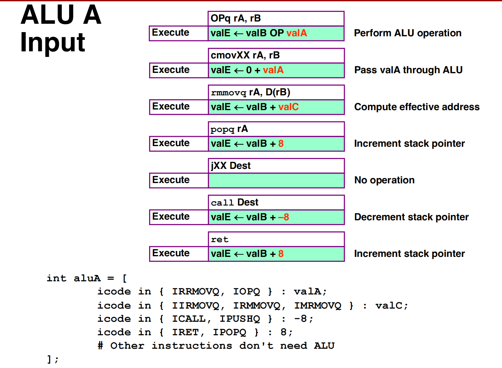
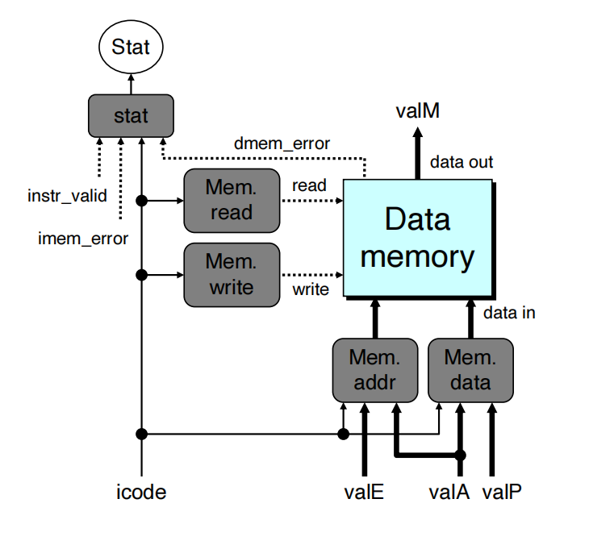
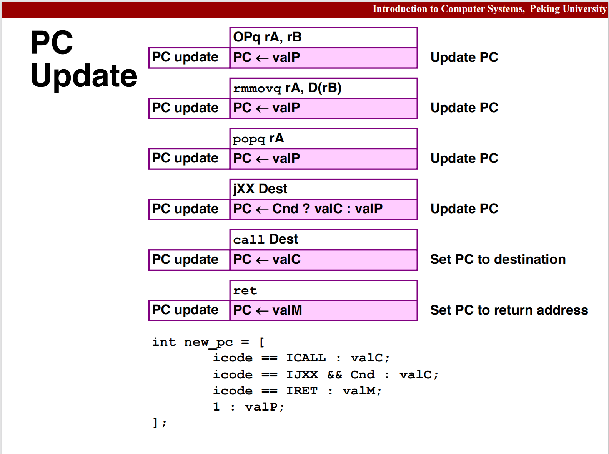
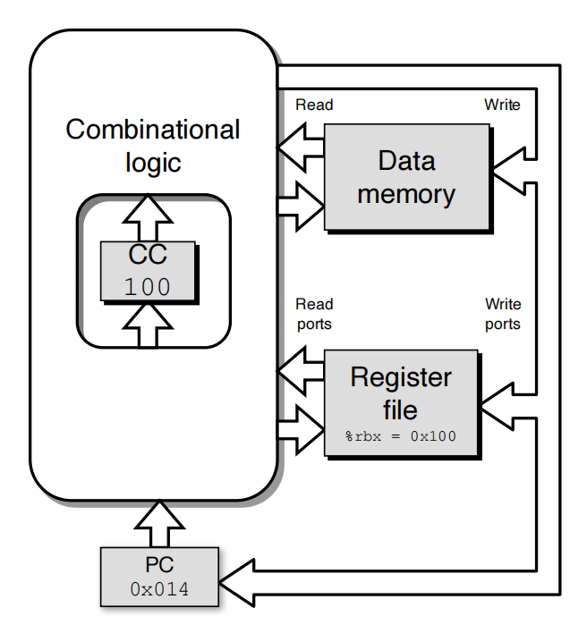

# 研讨题 2：SEQ 处理器部件设计

本文依据所提供的课件配图和逐题讨论，整理基本 Y86-64 SEQ 处理器的答案。讨论中的错误已在正文中修正。

约定：`R[r]` 表示编号为 `r` 的寄存器中的值，`RRSP` 是 `%rsp` 的寄存器编号，`RNONE` 表示不指定寄存器；`M8[a]` 表示从地址 `a` 开始的 8 字节内存数据。HCL 中用 `word` 表示数据或地址信号，用 `bool` 表示布尔信号。以下片段沿用课件中的指令常量名。



## （1）Fetch 部件各灰色框中信号的生成逻辑



### ① icode 和 ifun

指令存储器以 PC 为地址读取指令。`Split` 将指令首字节拆为两部分：高 4 位是指令类别 `icode`，低 4 位是功能码 `ifun`。记拆分得到的原始字段为 `imem_icode`、`imem_ifun`。

灰色框根据指令存储器产生的同一个 `imem_error` 选择输出：读取正常时输出原始字段；读取失败时，分别输出 `INOP` 和 `FNONE`。

```hcl
word icode = [
    imem_error : INOP;
    1 : imem_icode;
];

word ifun = [
    imem_error : FNONE;
    1 : imem_ifun;
];
```

`INOP = 0x1`，`FNONE = 0x0`，因此读取失败时并不是两个信号都输出 0。`icode = 0x0` 对应的是 `halt`。

`imem_error` 是指令存储器报告的访问错误，例如 PC 指向无法读取的越界地址；它不是由 `icode` 或 `ifun` 推算出来的。有效地址上没有预先放置程序，也不必然构成访问错误，读出的字节仍可能被解释为指令。

`FNONE` 本身不是错误标志。读取正常时，`ifun = FNONE` 表示原始低 4 位为 0；读取失败时，它是灰色框强制给出的默认值。是否读取失败应看 `imem_error`。

### ② instr_valid

`instr_valid` 检查 `icode` 是否属于支持的指令类别。基本 Y86-64 的有效类别编码为十六进制 `0x0`～`0xB`：属于这些类别时输出 1，否则输出 0。

```hcl
bool instr_valid = icode in {
    IHALT, INOP, IRRMOVQ, IIRMOVQ,
    IRMMOVQ, IMRMOVQ, IOPQ, IJXX,
    ICALL, IRET, IPUSHQ, IPOPQ
};
```

这段逻辑只检查指令类别，并不完整检查 `ifun` 或寄存器字段的合法性。读取失败时即使输出了默认的 `INOP`，仍可通过 `imem_error` 报告地址错误。

### ③ need_regids

`need_regids` 判断指令编码中是否包含寄存器指示字节，该字节的高、低 4 位分别编码 `rA` 和 `rB`。

```hcl
bool need_regids = icode in {
    IRRMOVQ, IIRMOVQ, IRMMOVQ, IMRMOVQ,
    IOPQ, IPUSHQ, IPOPQ
};
```

判断依据是“是否包含寄存器指示字节”，而不是“执行时是否使用寄存器”。例如，`call`、`ret` 隐含使用 `%rsp`，却不包含这个字节；`irmovq` 的某一寄存器字段为 `RNONE`，仍然包含这个字节。

### ④ need_valC

`need_valC` 判断指令编码中是否包含 8 字节常数字段。

```hcl
bool need_valC = icode in {
    IIRMOVQ, IRMMOVQ, IMRMOVQ, IJXX, ICALL
};
```

| 指令 | valC 的用途 |
| --- | --- |
| `irmovq` | 写入寄存器的立即数 |
| `rmmovq`、`mrmovq` | 内存寻址中的位移量，与基址寄存器值相加 |
| `jXX`、`call` | 绝对目标地址，不是相对 PC 的位移 |

`OPq` 和 `pushq` 不含 `valC`；更新栈指针所用的 ±8 是电路提供的固定常数。

这两个长度控制信号还用于计算顺序下一条指令的地址：

```text
valP = PC + 1 + need_regids + 8 × need_valC
```

其中布尔信号按 0 或 1 计算。`need_regids` 还控制 `Align`：存在寄存器指示字节时，`valC` 从 `PC + 2` 开始；否则从 `PC + 1` 开始。

## （2）Decode 部件各信号的基本用途



| 信号 | 基本用途 |
| --- | --- |
| `icode` | 指令类别，作为读写寄存器选择逻辑的依据 |
| `rA`、`rB` | 指令中编码的寄存器编号，不是寄存器中的数据 |
| `srcA`、`srcB` | 两个读端口的地址输入，指定要读取的寄存器编号 |
| `valA`、`valB` | 两个读端口读出的数据，即 `R[srcA]`、`R[srcB]`，对应端口被使用时有效 |
| `dstE` | E 写端口的地址输入，指定将 `valE` 写入哪个寄存器 |
| `dstM` | M 写端口的地址输入，指定将 `valM` 写入哪个寄存器 |
| `valE` | 执行阶段 ALU 产生的结果，送往 E 写端口 |
| `valM` | 从数据存储器读出的结果，送往 M 写端口 |
| `Cnd` | 执行阶段根据条件码和 `ifun` 产生的条件成立信号，在此图中参与条件传送的 `dstE` 选择 |

`icode` 本身不是选择器，四个灰色框才是选择逻辑。它们根据指令规则选择 `rA`、`rB`、`RRSP` 或 `RNONE`；`dstE` 对条件传送还要参考 `Cnd`。

条件传送成立时，`dstE = rB`；不成立时，`dstE = RNONE`，从而取消该次寄存器写入。其他指令的 `dstE` 选择不受 `Cnd` 影响。

需要区分寄存器编号与数据：`dstE` 不会变成 `valE`，而是指定执行 `R[dstE] ← valE` 的目标；`dstM` 同理。PC 的更新由另外的逻辑负责。

## （3）srcA 与 srcB 的生成逻辑



### ① srcA

```hcl
word srcA = [
    icode in { IRRMOVQ, IRMMOVQ, IOPQ, IPUSHQ } : rA;
    icode in { IPOPQ, IRET } : RRSP;
    1 : RNONE;
];
```

| 指令 | srcA 的选择及原因 |
| --- | --- |
| `rrmovq/cmovXX` | 选 `rA`，读取要传送的数据 |
| `rmmovq` | 选 `rA`，读取要存入内存的数据 |
| `OPq` | 选 `rA`，读取一个运算操作数 |
| `pushq` | 选 `rA`，读取要压栈的数据 |
| `popq`、`ret` | 选 `RRSP`，读取旧栈指针，作为随后读取栈内存的地址 |
| 其余 | 选 `RNONE`，不需要 A 读端口 |

`popq`、`ret` 在此处读到的是 `%rsp` 中的地址；栈里的数据要到访存阶段才读出。

### ② srcB

```hcl
word srcB = [
    icode in { IRMMOVQ, IMRMOVQ, IOPQ } : rB;
    icode in { IPUSHQ, IPOPQ, ICALL, IRET } : RRSP;
    1 : RNONE;
];
```

`rmmovq`、`mrmovq` 需要 `rB` 中的基址来计算 `R[rB] + valC`；`OPq` 需要 `rB` 中的旧值参与运算。四条栈相关指令需要旧 `%rsp` 来计算更新后的栈指针。

`rrmovq` 和 `irmovq` 虽然会写入 `rB`，但不需要读取它的旧值，因此不通过 B 端口读取 `rB`。

判断读寄存器的依据是：后续计算、地址生成或访存是否需要其旧值。目标寄存器也可能同时是源寄存器，例如 `addq rA, rB` 要先读取两个寄存器，再用结果覆盖 `rB`。

## （4）dstE 与 dstM 的生成逻辑



### ① dstE

`dstE` 指定 ALU 结果 `valE` 要写入的寄存器。

```hcl
word dstE = [
    icode == IRRMOVQ && Cnd : rB;
    icode in { IIRMOVQ, IOPQ } : rB;
    icode in { IPUSHQ, IPOPQ, ICALL, IRET } : RRSP;
    1 : RNONE;
];
```

- `rrmovq/cmovXX`：条件成立时写入 `rB`，否则不写；无条件 `rrmovq` 对应的条件恒成立。
- `irmovq`、`OPq`：将传递的立即数或运算结果写入 `rB`。
- `pushq`、`call`：将旧 `%rsp − 8` 写回 `%rsp`。
- `popq`、`ret`：将旧 `%rsp + 8` 写回 `%rsp`。
- 其余指令不通过 E 端口写寄存器，选择 `RNONE`。

不能仅凭“目标操作数是寄存器”就认定使用 `dstE`。例如 `mrmovq` 写入的是内存读出的 `valM`，要使用 `dstM`。

### ② dstM

`dstM` 指定内存读出结果 `valM` 要写入的寄存器。

```hcl
word dstM = [
    icode in { IMRMOVQ, IPOPQ } : rA;
    1 : RNONE;
];
```

- `mrmovq`：将内存读出的数据写入 `rA`。
- `popq`：将弹出的数据写入 `rA`；栈指针的加 8 结果另经 `dstE` 写回 `%rsp`。
- `ret`：内存读出的 `valM` 是返回地址，用来更新 PC，不通过 M 端口写寄存器，因此 `dstM = RNONE`。

核心区别：弹出的数据或返回地址是 `valM`，栈指针加减 8 的结果是 `valE`。

## （5）ALU A 与 ALU B 的生成逻辑



ALU 的两个输入是 `aluA` 和 `aluB`。课件将运算写为 `valE ← aluB OP aluA`；特别是减法，顺序是 `aluB − aluA`。

### ① aluA

```hcl
word aluA = [
    icode in { IRRMOVQ, IOPQ } : valA;
    icode in { IIRMOVQ, IRMMOVQ, IMRMOVQ } : valC;
    icode in { ICALL, IPUSHQ } : -8;
    icode in { IRET, IPOPQ } : 8;
    1 : 0;
];
```

- `rrmovq/cmovXX`：通过 `0 + valA` 传递源寄存器数据。
- `OPq`：用 `valA` 提供一个运算操作数。
- `irmovq`：通过 `0 + valC` 传递立即数。
- `rmmovq`、`mrmovq`：用 `valC` 提供地址位移量。
- `call`、`pushq`：提供 `−8`，用于栈指针递减。
- `ret`、`popq`：提供 `8`，用于栈指针递增。

最后一行给其余指令提供确定的默认输入，这些指令不使用 ALU 结果。

### ② aluB

```hcl
word aluB = [
    icode in { IRRMOVQ, IIRMOVQ } : 0;
    icode in {
        IRMMOVQ, IMRMOVQ, IOPQ,
        ICALL, IPUSHQ, IRET, IPOPQ
    } : valB;
    1 : 0;
];
```

| 指令类别 | ALU 的计算 |
| --- | --- |
| `rrmovq/cmovXX` | `0 + valA`，传递寄存器数据 |
| `irmovq` | `0 + valC`，传递立即数 |
| `rmmovq`、`mrmovq` | `valB + valC`，计算有效地址 |
| `OPq` | `valB OP valA`，进行指定运算 |
| `call`、`pushq` | `valB − 8`，计算新栈指针 |
| `ret`、`popq` | `valB + 8`，计算新栈指针 |

其中四条栈相关指令的 `valB` 都是旧 `%rsp`。`irmovq` 的 `aluB` 应为 0，不需要目的寄存器的旧值。

## （6）Memory 部件各信号的基本用途



| 信号 | 基本用途 |
| --- | --- |
| `icode` | 提供指令类别，供各控制模块生成访存和状态信号 |
| `mem_read` | 数据存储器的读使能，1 表示需要读取 |
| `mem_write` | 数据存储器的写使能，1 表示需要写入 |
| `mem_addr` | 读或写的内存地址，从 `valE`、`valA` 中选择 |
| `mem_data` | 写入内存的数据，从 `valA`、`valP` 中选择 |
| `valE` | ALU 结果；访存时可用作有效地址或压栈后的新栈地址 |
| `valA` | `rmmovq/pushq` 的待存数据，或 `popq/ret` 读取栈内存所用的旧栈指针 |
| `valP` | 顺序下一条指令地址；在此图中用于 `call` 压栈保存返回地址 |
| `valM` | 数据存储器读出的数据 |
| `dmem_error` | 数据存储器报告的访问错误，例如访问越界 |
| `imem_error` | 指令存储器报告的取指访问错误 |
| `instr_valid` | 指令类别是否受支持 |
| `stat` | 综合访问错误、指令有效性和停机指令，生成处理器状态，向 `Stat` 输出 |

`icode` 中不是另外设置了专用的读写状态位，而是访存控制逻辑根据指令类别生成控制信号。

状态生成逻辑可表示为：

```hcl
word stat = [
    imem_error || dmem_error : SADR;
    !instr_valid : SINS;
    icode == IHALT : SHLT;
    1 : SAOK;
];
```

其中 `ADR` 表示地址错误，`INS` 表示非法指令，`HLT` 表示停机，`AOK` 表示正常。上面的分支按从上到下的优先顺序选择。

## （7）Memory Data 与 Memory Write 的生成逻辑

### ① Memory Data

```hcl
word mem_data = [
    icode in { IRMMOVQ, IPUSHQ } : valA;
    icode == ICALL : valP;
    1 : 0;
];
```

`rmmovq` 将源寄存器数据存入内存，`pushq` 将源寄存器数据压栈，因此都选择 `valA`。`call` 要保存返回地址，因此选择顺序下一条指令地址 `valP`。

### ② Memory Write

```hcl
bool mem_write = icode in { IRMMOVQ, IPUSHQ, ICALL };
```

只有这三类指令需要写数据存储器。

| 指令 | 写入地址 | 写入数据 |
| --- | --- | --- |
| `rmmovq` | `valE = R[rB] + valC` | `valA = R[rA]` |
| `pushq` | `valE = 旧 %rsp − 8` | `valA = R[rA]` |
| `call` | `valE = 旧 %rsp − 8` | `valP`，返回地址 |

访存地址和读使能的配套逻辑如下，可用于理解完整数据通路：

```hcl
word mem_addr = [
    icode in { IRMMOVQ, IMRMOVQ, IPUSHQ, ICALL } : valE;
    icode in { IPOPQ, IRET } : valA;
    1 : 0;
];

bool mem_read = icode in { IMRMOVQ, IPOPQ, IRET };
```

`popq/ret` 要先从旧栈顶读数据，所以访存地址用旧 `%rsp`，即 `valA`；它们的 `valE` 已是加 8 后的新栈指针，不能用它读取当前要弹出的数据。

## （8）PC 更新逻辑



```hcl
word new_pc = [
    icode == ICALL : valC;
    icode == IJXX && Cnd : valC;
    icode == IRET : valM;
    1 : valP;
];
```

- `call`：转到指令中编码的目标地址 `valC`。
- `jXX`：条件成立时转到 `valC`，否则顺序执行 `valP`。无条件跳转 `jmp` 的条件恒成立。
- `ret`：将栈中读出的返回地址 `valM` 作为下一条指令地址。
- 其余情况：选择 `valP`，继续顺序执行。

`jXX` 和 `call` 中的 `valC` 是指令内编码的 8 字节绝对目标地址。`new_pc` 是组合逻辑计算出的待更新值；PC 寄存器要在有效时钟边沿到来时才保存它。

## （9）SEQ 执行一条指令的完整过程与状态更新时间



### ① 六个逻辑阶段在一个时钟周期内完成

SEQ 的执行过程包括取指、译码、执行、访存、写回和 PC 更新。这些是逻辑阶段，不是六个独立的时钟周期。

一个周期内，信号从当前 PC 和其他存储状态出发，依次经过各部分组合逻辑，形成需要保存的结果。周期必须足够长，让所需数据、写入地址和写使能等控制信号在下一个上升沿前稳定下来。内存和寄存器的读取在本课件模型中参与周期内的数据传播；写入则在有效边沿提交。

SEQ 不将多条指令重叠执行：本条指令的结果在周期末保存后，下一条才基于新状态开始计算。它是一条指令占一个较长周期，而不是一条指令占五个周期、依靠重叠达到每周期完成一条；后者描述的是典型流水线的理想吞吐方式。

### ② 周期内计算，上升沿保存

```text
上升沿 t_n                                        上升沿 t_(n+1)
    │                                                   │
    ├─ 取指 → 译码 → 执行 → 访存读取 → 待写入结果稳定 ─────┤
    │                                                   └─ 按需保存状态
    │                                                      然后开始下一条计算
```

| 存储部件 | 两个有效边沿之间 | 下一上升沿到来时 |
| --- | --- | --- |
| PC | 保存当前指令地址，组合逻辑据此计算 `new_pc` | 保存 `new_pc` |
| 寄存器文件 | 读端口提供当前值，电路准备写地址、数据 | 按 `dstE/dstM` 写入 `valE/valM`；`RNONE` 对应端口不写 |
| 条件码 CC | 当前条件码供条件判断使用；电路计算候选新条件码 | 基本 SEQ 中，执行 `OPq` 时更新 ZF、SF、OF；其他指令保持 |
| 数据存储器 | 有效读操作产生 `valM`；电路准备写地址和写数据 | `mem_write = 1` 时写入，否则保持 |

这里讨论的是正常、无访问错误的指令执行过程。“边沿同时保存”指同步逻辑模型中的状态更新；硬件仍有实际传播时间，需要满足时序要求。

组合逻辑可以比作草稿纸：各部分在周期内并行计算，并按数据依赖继续传播；等结果稳定，上升沿统一将需要保留的结果写入正式记录。更新后的记录再用于下一轮计算。

这个比喻有两个边界：中间结果的先后不是任意的，依赖某输入的结果必须等待该输入；周期内稳定的是待写入信号，存储部件并未提前更新。

### ③ 例：执行 call 0x200

假设本条 `call` 指令位于 `PC = 0x100`，当前 `%rsp = 0x1000`，指令和栈地址均有效。基本 Y86-64 的 `call` 长 9 字节：1 字节指令首字节，加 8 字节目标地址。

| 阶段 | 当前周期中的计算或操作 |
| --- | --- |
| 取指 | 得到 `icode = ICALL`、`valC = 0x200`；不含寄存器字节，故 `valP = 0x100 + 9 = 0x109` |
| 译码 | `srcB = RRSP`，读出 `valB = 0x1000`；A 读端口不需要使用 |
| 执行 | `aluA = -8`、`aluB = valB`，得到 `valE = 0xFF8`；不更新 CC |
| 访存 | 准备向地址 `mem_addr = valE = 0xFF8` 写入 `mem_data = valP = 0x109`，令 `mem_write = 1` |
| 写回 | 准备通过 `dstE = RRSP` 将 `valE = 0xFF8` 写回 `%rsp`；`dstM = RNONE` |
| PC 更新 | 组合逻辑得到 `new_pc = valC = 0x200` |

到下一个上升沿，提交以下状态更新：

```text
M8[0xFF8] ← 0x109      保存返回地址
R[%rsp]   ← 0xFF8      更新栈指针
PC        ← 0x200      转到被调用过程
CC 保持不变，其他通用寄存器保持不变
```

这些写入的地址和值，都已经在边沿前由当前 `call` 指令准备好。边沿之后，新 PC 开始驱动目标地址处的取指；若下一条指令读取 `%rsp`，会读到更新后的 `0xFF8`。下一条指令的结果还要等再下一个上升沿才能保存，因此不会与当前指令的提交混淆。

### ④ 其他指令的状态变化举例

- `OPq`：将 ALU 结果写入目标寄存器，更新 CC，PC 更新为 `valP`；不写数据存储器。
- `rmmovq`：写数据存储器，PC 更新为 `valP`；不写通用寄存器，不更新 CC。
- `mrmovq`：周期内从内存读出 `valM`，在边沿写入 `rA`，PC 更新为 `valP`；不更新 CC。
- `popq`：周期内从旧栈顶读出 `valM`，在边沿通过 M 端口写入 `rA`，通过 E 端口更新 `%rsp`，并更新 PC；不更新 CC。若目标恰为 `%rsp`，最终应以弹出值作为 `%rsp` 的结果。
- `ret`：周期内从旧栈顶读出返回地址 `valM`，在边沿将其保存到 PC，同时将 `%rsp` 加 8；不通过 M 端口写寄存器，不更新 CC。

因此，一条指令经过多个逻辑阶段，但存储状态的更新集中在有效时钟边沿；并不是每完成一个阶段就写一次状态，也不是 PC 在周期内连续更新。
