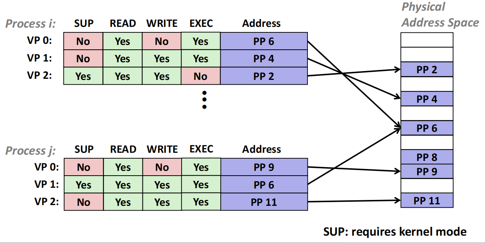
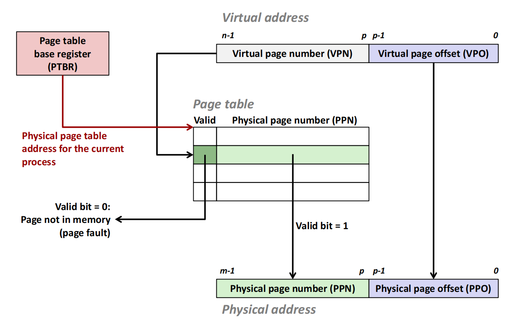
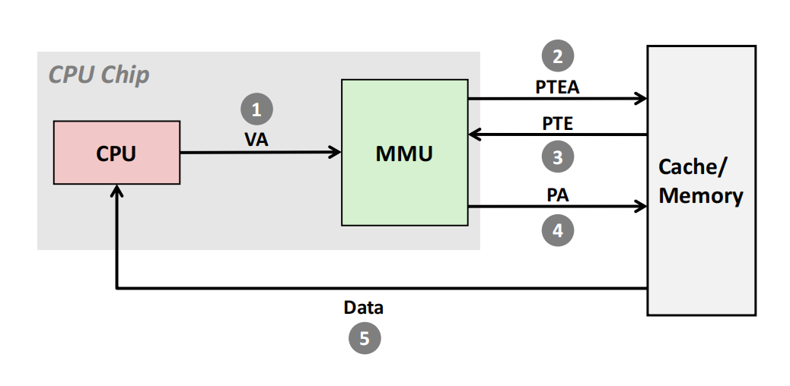
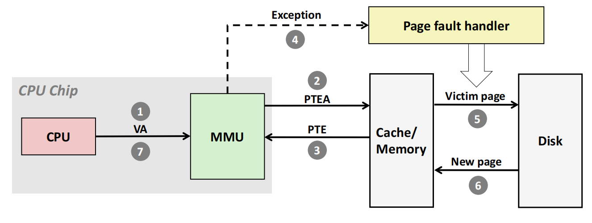
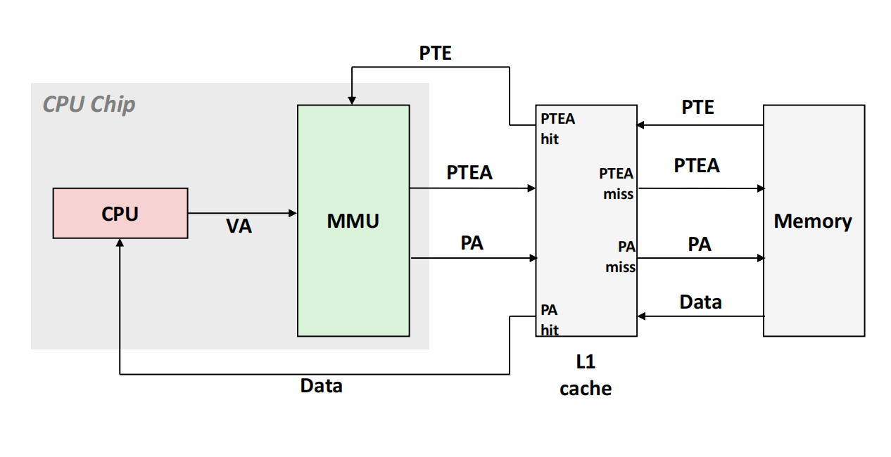
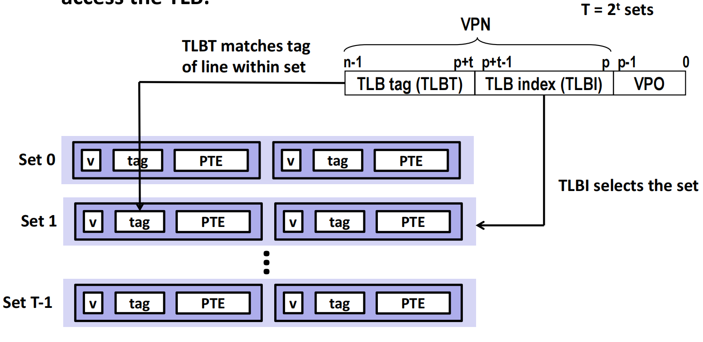
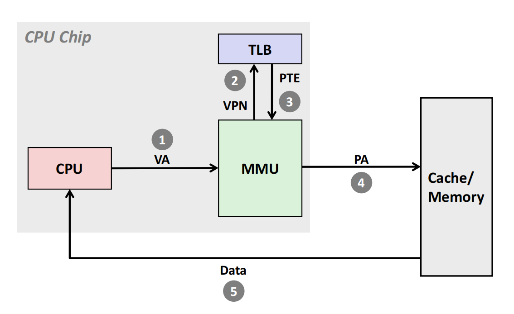
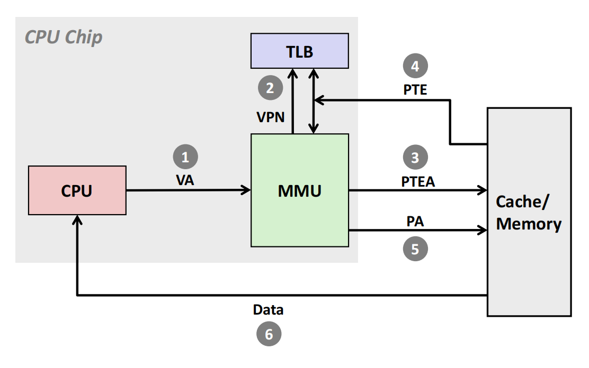
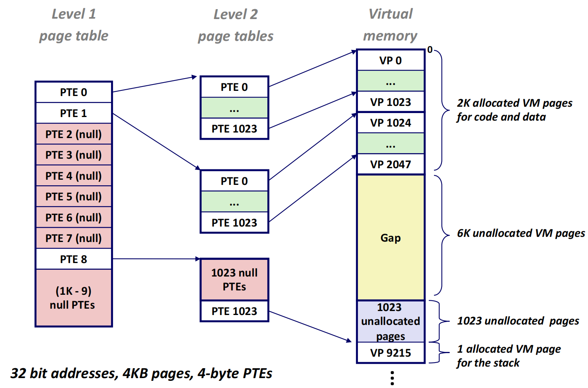
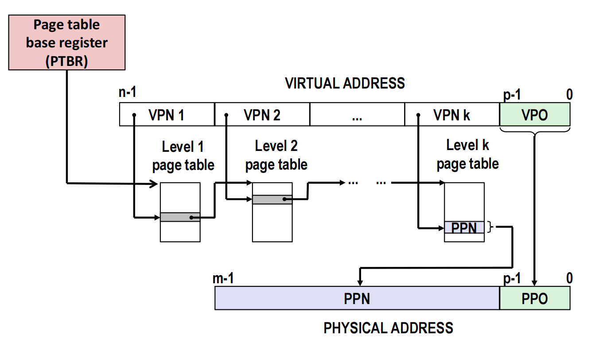

# ICS 第 19 讲研讨题二

## 题目（1）

基于课件第 28～29 页，说明虚拟存储作为内存管理的工具，主要有哪些用途。再基于课件第 30 页，说明虚拟存储对链接和加载的影响。

### 答案

1. **虚拟存储作为内存管理工具的用途**

   - **简化内存分配。** 连续的虚拟页可以映射到分散的物理页。同一个虚拟页在不同时刻也可以映射到不同的物理页。
   - **简化进程间共享。** 不同进程的虚拟页可以映射到同一个物理页，例如共用一份只读的共享库代码。

2. **虚拟存储对链接和加载的影响**

   - **简化链接。** 每个进程都有独立的虚拟地址空间，可以采用相同的基本布局。链接器按虚拟地址安排代码和数据，运行时由页表映射到物理内存。
   - **简化加载。** `execve` 为 `.text` 和 `.data` 建立文件映射，尚未驻留的页对应的 PTE 标为无效。首次访问这类页时触发缺页异常，操作系统载入所需页并更新 PTE。共享对象也可通过文件映射按需加载。

## 题目（2）

基于课件第 32 页，说明虚拟存储如何实现存储保护，并对每个权限位进行解释。

### 答案

1. **如何实现存储保护**

   操作系统用独立的虚拟地址空间隔离各进程的私有内存，并在页表条目（PTE）中设置每个虚拟页的权限。每次访存时，MMU 按访问类型和 CPU 当前特权级检查权限。TLB 命中时可使用缓存的权限。访问违反权限时，处理器触发异常，由操作系统处理。

2. **权限位解释**

   

   <!-- 制作 PPT 时省略下方四个权限位的图示说明。 -->

   - **SUP（Supervisor）** 为 Yes 时，访问要求内核模式。为 No 时，用户模式也可按其余权限位访问。
   - **READ（R）** 控制能否从该页读取数据。
   - **WRITE（W）** 控制能否向该页写入数据。
   - **EXEC（X）** 控制能否从该页取指执行。

## 题目（3）

基于课件第 35～36 页，先解释各个名词含义，包括 VA、VPO、VPN、PA、VPO、VPN，再分步骤说明地址转换的过程。

### 答案

1. **名词解释**

   - **VA**（Virtual Address）虚拟地址。
   - **VPO**（Virtual Page Offset）虚拟页内偏移量。
   - **VPN**（Virtual Page Number）虚拟页号。
   - **PA**（Physical Address）物理地址。
   - **PPO**（Physical Page Offset）物理页内偏移量，和 VPO 相同。
   - **PPN**（Physical Page Number）物理页号。

2. **地址转换过程**

   

   1. 将 `n` 位虚拟地址 VA 拆成高 `n − p` 位 VPN 和低 `p` 位 VPO，其中页大小为 `2^p` 字节。
   2. 以 VPN 为索引查页表。PTBR（页表基址寄存器）保存当前进程页表的物理基址。MMU 计算 `PTE 地址 = PTBR 中的基址 + VPN × 每个 PTE 的字节数`，再读取该页表条目。
   3. 检查 PTE 的有效位。有效位为 0 时触发缺页异常。有效位为 1 时，取出 PPN 作为物理地址的高位，保留 VPO 作为低 `p` 位 PPO，拼接得到物理地址 PA。

## 题目（4）

基于课件第 37～38 页，在结构图上解读 Page Hit 和 Page Fault 两种情况下，地址转换的步骤。再基于课件第 39 页，详细说明各种情况下的数据流转经过哪些线条，包括 PTEA hit、PTEA miss、PA hit、PA miss。

### 答案

1. **Page Hit 和 Page Fault 时的地址转换**

   两种情况的前 3 步相同。① CPU 把虚拟地址 VA 交给 MMU。② MMU 算出页表条目的物理地址 PTEA 并发给 Cache/Memory。③ Cache/Memory 把 PTE 返回给 MMU。

   **Page Hit（课件第 37 页）**

   

   - ④ PTE 的有效位为 1，说明目标页已在物理内存。MMU 将 PTE 中的 PPN 与 VPO 拼接成物理地址 PA，发给 Cache/Memory。
   - ⑤ Cache/Memory 将 PA 对应的数据返回给 CPU。

   **Page Fault（课件第 38 页）**

   

   - ④ PTE 的有效位为 0，MMU 触发缺页异常，处理器转入内核的缺页异常处理程序。图中以访问合法但尚未驻留的页为例。
   - ⑤ 若有空闲物理页，处理程序可直接使用。若需要腾出物理页，则选择牺牲页，脏页须先写回磁盘。换出后，将牺牲页对应的 PTE 标为无效。
   - ⑥ 处理程序从磁盘调入所需页，更新该页的 PTE，写入 PPN 并将有效位置为 1。
   - ⑦ 处理程序返回原进程，重新执行引发缺页的指令。这次目标页已驻留，按 Page Hit 的流程完成访问。

2. **PTEA hit、PTEA miss、PA hit、PA miss 的数据流转**

   

   CPU 先沿 VA 线把虚拟地址发给 MMU。接下来按图进行两次 L1 Cache 查找。

   - **PTEA hit**。`MMU ─PTEA→ L1 Cache ─PTE→ MMU`
   - **PTEA miss**。`MMU ─PTEA→ L1 Cache ─PTEA→ Memory ─PTE→ L1 Cache ─PTE→ MMU`

   MMU 拿到有效的 PTE 后，用 PPN 和 VPO 拼出 PA，再查找目标数据。

   - **PA hit**。`MMU ─PA→ L1 Cache ─Data→ CPU`
   - **PA miss**。`MMU ─PA→ L1 Cache ─PA→ Memory ─Data→ L1 Cache ─Data→ CPU`

## 题目（5）

基于课件第 40 页，解释 TLB 的作用，并说明为什么要有 TLB，以及 TLB 和 L1 Cache 之间是什么关系。结合后面的内容，分析 TLB 为什么叫这个名字。

### 答案

1. **TLB 的作用**

   TLB 是 MMU 中的小型硬件缓存。它按虚拟页号 VPN 缓存近期用到的地址转换信息，包括物理页号 PPN 和访问权限，从而加快地址转换。

2. **为什么需要 TLB**

   查页表需要访问缓存或内存来读 PTE。即使 PTE 在 L1 Cache 中，也要花一次访问 L1 的时间，而且 PTE 可能被其他数据挤出。程序经常在短时间内重复访问同一个虚拟页或访问同一页内的相邻地址，这些访问可以复用同一条 TLB 记录，省去查页表的开销。

3. **TLB 和 L1 Cache 的关系**

   按课件的简化模型，MMU 先用 VPN 查 TLB。命中时直接取得转换信息。未命中时，MMU 查页表，读取 PTE 时先按 PTEA 查 L1 Cache，L1 未命中再从内存取。得到有效的转换信息后可填入 TLB。拼出物理地址 PA 后，仍需用 PA 访问缓存或内存来取得目标数据。

4. **TLB 为什么叫这个名字**

   TLB 全称是 Translation Lookaside Buffer（地址转换后备缓冲器，常称快表）。Translation 指它保存地址转换信息，Lookaside 指 MMU 在常规查页表前先查这块旁路缓存，命中就可以跳过查页表，Buffer 指它暂存少量近期使用的转换条目。

## 题目（6）

基于课件第 41～42 页，说明 TLB 的结构和操作过程，并对比和之前学习的高速缓存的结构及操作过程的异同。

### 答案

1. **TLB 的结构**

   

   图中是一个两路组相联 TLB，每一行是一组，每组有两路。每个条目有三部分。`v` 是该 TLB 条目的有效位，`tag` 是标记，`PTE` 保存页表项中的转换信息。

2. **TLB 的查找过程**

   - MMU 从 VA 取出 VPN。VPN 的低 `t` 位是组索引 TLBI，其余高位是标记 TLBT，共有 `2^t` 组。
   - 用 TLBI 选中一组，再把 TLBT 与该组各路的标记比较。有一条记录的 `v=1` 且标记相同就命中，MMU 取出转换信息，并把得到的 PPN 和原来的 VPO 拼成 PA。
   - 组内没有匹配的有效条目时，MMU 查页表，取得有效的转换信息后可填入 TLB。

3. **与高速缓存的异同**

   - **相同点。** 两者都可以采用组相联组织，按索引选组、按标记和有效位判断命中，未命中时从后续层级取得所需内容并填入缓存。
   - **缓存内容和用途。** TLB 缓存页级地址转换信息，供 MMU 生成 PA。课件中的 L1 Cache 缓存内存数据块，其中也可能包含 PTE。
   - **使用的地址字段。** TLB 用 VPN 的组索引和标记查找，VPO 保留到物理地址中。课件中的 L1 Cache 用 PA 的组索引和标记查找，再用块内偏移选出所需数据。

## 题目（7）

基于课件第 43～44 页，说明 TLB Hit 和 Miss 两种情况下访存的过程，并对比和第 37 页操作过程的异同。

### 答案

1. **TLB Hit 和 TLB Miss 时的访存过程**

   两种情况的前两步相同。① CPU 将 VA 交给 MMU。② MMU 用 VA 中的 VPN 查 TLB。

   **TLB Hit（课件第 43 页）**

   

   - ③ TLB 将缓存的 PTE 转换信息交给 MMU。
   - ④ MMU 把 PPN 和 VPO 拼成 PA，将 PA 发给 Cache/Memory。
   - ⑤ Cache/Memory 将目标数据返回给 CPU。

   **TLB Miss（课件第 44 页）**

   

   - ③ MMU 查页表，将 PTEA 发给 Cache/Memory。
   - ④ Cache/Memory 返回 PTE。若 PTE 有效，MMU 取得转换信息并填入 TLB。若 PTE 无效，则转入缺页处理。
   - ⑤ MMU 把 PPN 和 VPO 拼成 PA，将 PA 发给 Cache/Memory。
   - ⑥ Cache/Memory 将目标数据返回给 CPU。

2. **与第 37 页 Page Hit 流程的异同**

   <!-- 制作 PPT 时，在第 7 题的对比页设置按钮，跳到第 4 题的 Page Hit 图（课件第 37 页），并在第 4 题该页设置返回第 7 题对比页的按钮。 -->

   三种流程都要生成 PA 并用它访问目标数据。按课件的图，在目标页已驻留且访问权限允许时，访问 Cache/Memory 的次数如下。

   - **第 37 页未引入 TLB。** 共两次，一次读 PTE，一次取目标数据。
   - **TLB Hit。** 共一次，只取目标数据，省去读 PTE 的访问。
   - **TLB Miss。** 同样是两次，一次读 PTE，一次取目标数据。流程增加了 TLB 查找和回填。

## 题目（8）

基于课件第 45～46 页，解读为什么需要多级页表，对比示例中的二级页表和之前一级页表之间的区别。

### 答案

1. **为什么需要多级页表**

   48 位虚拟地址按字节编址。页大小为 4 KiB，也就是 `2^12` 字节，所以页内偏移占 12 位，VPN 占 36 位。平铺的一级页表要为每个虚拟页预留一项。每个 PTE 占 8 字节，整张表就需要 `2^36 × 8 = 2^39` 字节，也就是 **512 GiB**。进程通常只使用虚拟地址空间中的少数区域。多级页表只为用到的区域分配下一级页表，节省页表空间。

2. **二级页表和一级页表的区别**

   

   - **一级页表。** 用整个 VPN 直接索引平铺的页表，查到的 PTE 在页面驻留时给出 PPN。
   - **二级页表。** VPN 拆成两段。第一段索引根页表，根表项指向二级页表。第二段索引该二级页表，末级 PTE 在页面驻留时给出 PPN。整个地址区域未分配时，对应根表项可留空，省掉整张二级页表。
   - **课件第 46 页的例子。** 32 位虚拟地址、4 KiB 页、4 字节 PTE。VPN 分为两个 10 位索引，每张表各占 4 KiB。示例为代码、数据和栈分配了 3 张二级表，加上根表总计 **16 KiB**。同样条件下，覆盖整个虚拟地址空间的平铺一级页表占 **4 MiB**。

## 题目（9）

基于课件第 47 页和之前的两页，将二级页表推广到 k 级页表，说明地址转换的过程。

### 答案

1. **拆分虚拟地址。** VA 的低 `p` 位是 VPO。把高位的 VPN 从高到低拆成 `VPN₁`、`VPN₂`、…、`VPNₖ`，分别作为各级页表的索引。
2. **从根页表逐级向下查。** PTBR 保存第一级页表的物理基址。对前 `k − 1` 级，MMU 依次用 `VPNᵢ` 索引第 `i` 级页表，并从有效的 PTE 取得下一级页表的物理基址。
3. **从末级页表取得 PPN。** 用 `VPNₖ` 索引第 `k` 级页表，从有效的 PTE 取出目标页的物理页号 PPN。若途中遇到无效的 PTE，则触发缺页异常。
4. **拼接物理地址。** PPN 是物理地址的高位，原来的 VPO 直接作为低 `p` 位的 PPO。两部分拼成 PA。
